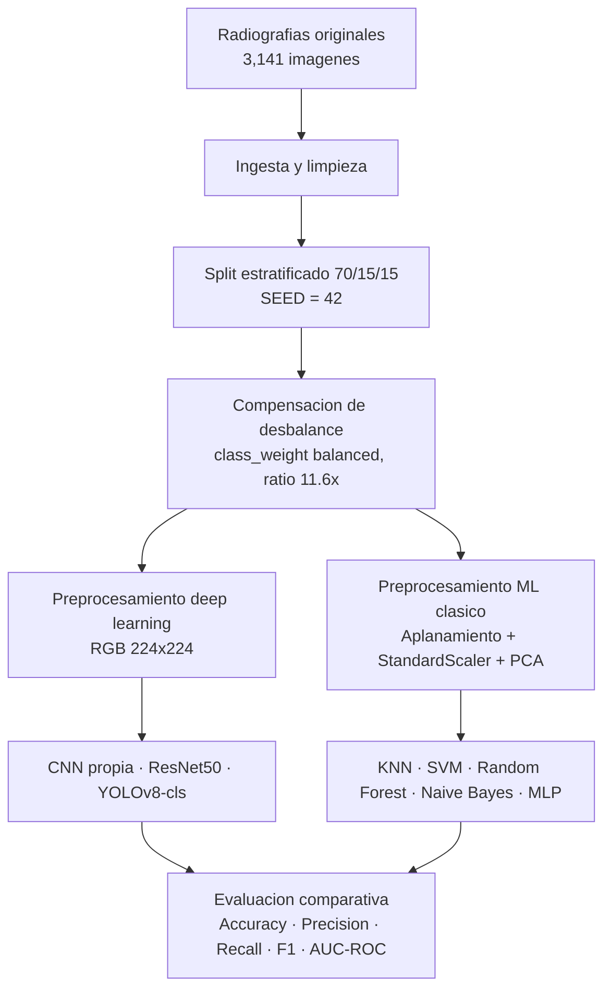

# Clasificación de Radiografías Respiratorias: COVID-19, Neumonía y Normal

## Resumen ejecutivo

Este proyecto compara ocho algoritmos de aprendizaje supervisado para clasificar radiografías de tórax en tres clases: COVID-19, Neumonía y Normal. Incluye modelos de deep learning (CNN propia, ResNet50 con transfer learning y YOLOv8-cls) y modelos de ML clásico (KNN, SVM, Random Forest, Naive Bayes y MLP) sobre representaciones reducidas con PCA.

## Planteamiento del problema

Se trata de una clasificación multiclase con clases desbalanceadas. En un contexto de cribado médico, el error más costoso es el falso negativo: un caso positivo clasificado como negativo. Por ello, la métrica de referencia es la **sensibilidad (Recall)** por clase, y no solo la accuracy global. En particular, la clase COVID-19 es la menos representada y la que más requiere atención.

## Dataset y protocolo experimental

- **Imágenes:** 3,141 radiografías, redimensionadas a 224 × 224 píxeles en RGB.
- **Partición:** estratificada 70 / 15 / 15 (entrenamiento / validación / prueba) con `SEED = 42`.
- **Desbalance:** razón de 11.6× entre la clase mayoritaria y la minoritaria. Se compensa con `class_weight='balanced'` en los modelos que lo soportan.
- **Preprocesamiento dual:**
  - Deep learning: imágenes RGB de 224 × 224.
  - ML clásico: aplanamiento, `StandardScaler` y PCA a ~300 componentes (≥ 95 % de varianza explicada).

## Arquitectura del pipeline

## Modelos evaluados

| ID | Modelo | Tipo | Entrada | Estado |
|---|---|---|---|---|
| A | CNN propia | Deep learning | RGB 224 × 224 | **Pendiente de revalidación** |
| B1 | K-Nearest Neighbors | Clásico + PCA | Vector PCA | Verificado |
| B2 | Support Vector Machine (RBF) | Clásico + PCA | Vector PCA | Verificado |
| B3 | Random Forest | Ensamble + PCA | Vector PCA | Verificado |
| B4 | Gaussian Naive Bayes | Probabilístico + PCA | Vector PCA | Verificado |
| C | Multi-Layer Perceptron | Red neuronal + PCA | Vector PCA | Verificado |
| D | ResNet50 (transfer learning + fine-tuning) | Deep learning | RGB 224 × 224 | Verificado |
| E | YOLOv8-cls | Deep learning | RGB 224 × 224 | Verificado |

## Resultados

Las métricas son promedios ponderados sobre el conjunto de prueba (472 imágenes), ordenados por accuracy.

| Modelo | Accuracy | Precision | Recall | F1-Score | AUC-ROC |
|---|---|---|---|---|---|
| YOLOv8-cls (E) | 0.9767 | 0.9772 | 0.9767 | 0.9767 | 0.9980 |
| ResNet50 (D) | 0.9746 | 0.9752 | 0.9746 | 0.9747 | 0.9973 |
| MLP (C) | 0.9682 | 0.9684 | 0.9682 | 0.9682 | 0.9930 |
| SVM (B2) | 0.9640 | 0.9643 | 0.9640 | 0.9640 | 0.9955 |
| KNN (B1) | 0.9301 | 0.9302 | 0.9301 | 0.9301 | 0.9796 |
| Random Forest (B3) | 0.8475 | 0.8520 | 0.8475 | 0.8440 | 0.9614 |
| Naive Bayes (B4) | 0.6377 | 0.6551 | 0.6377 | 0.6208 | 0.8237 |
| CNN propia (A) | — | — | — | — | — |

La CNN propia no se reporta: su entrenamiento no convergió (accuracy de validación constante en 0.0445) y se encuentra en revisión. Sus métricas se incorporarán tras el reentrenamiento.

### Desempeño por clase: Random Forest

| Clase | Precision | Recall | F1-Score | Soporte |
|---|---|---|---|---|
| COVID-19 | 1.00 | 0.43 | 0.60 | 21 |
| Neumonía | 0.83 | 0.90 | 0.86 | 241 |
| Normal | 0.86 | 0.83 | 0.85 | 210 |

El Recall de COVID-19 es 0.43: el modelo detecta 9 de 21 casos. El promedio ponderado (0.85) oculta esta deficiencia, por lo que el análisis por clase es necesario en el contexto de cribado. Las métricas por clase de los demás modelos se incorporarán en la siguiente fase.

## Visualizaciones

Las figuras se referencian desde `reports/figures/`. Su estado de copia se indica a continuación.

| Figura | Archivo | Estado |
|---|---|---|
| Distribución de clases | `reports/figures/eda_01_distribucion.png` | Pendiente de copiar |
| Muestras por clase | `reports/figures/eda_02_muestras.png` | Pendiente de copiar |
| Histogramas de intensidad | `reports/figures/eda_03_histogramas.png` | Pendiente de copiar |
| Curvas de entrenamiento CNN | `reports/figures/cnn_training_curves.png` | Pendiente (requiere revalidación) |
| Curvas de entrenamiento ResNet50 | `reports/figures/resnet_training_curves.png` | Pendiente de copiar |
| Comparativa final | `reports/figures/comparativa_final.png` | Pendiente de copiar |

## Reporte técnico

El reporte completo se encuentra en [reports/Final_Report_Chest_XRay.pdf](reports/Final_Report_Chest_XRay.pdf).

## Pendientes conocidos

1. Revalidar la CNN propia (evaluación y entrenamiento).
2. Incluir Random Forest en la tabla comparativa generada por el notebook.
3. Reemplazar las rutas absolutas del notebook por variables de entorno.
4. Documentar la procedencia de `models/mlp_model.onnx`.
5. Extraer `src/` (preprocesamiento, modelos y evaluación) del notebook.
6. Revisar compatibilidad de `ImageDataGenerator` con Keras 3 antes de reentrenar la CNN.

## Entorno

Entrenamiento ejecutado en CPU (`device=cpu` en YOLOv8). Las versiones de `requirements.txt` corresponden a un entorno de verificación en macOS y pueden diferir del entorno original de entrenamiento, que no quedó documentado.
